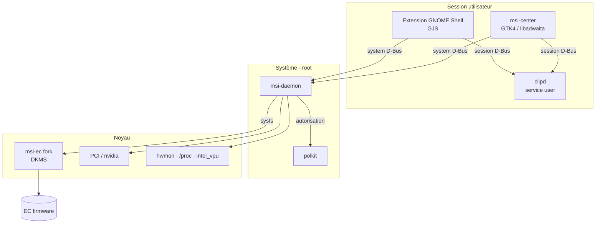

# Architecture — vue d'ensemble

## Principes

1. **Séparation des privilèges** : seul `msi-daemon` tourne en root. Tout le reste est utilisateur.
2. **Cœur fonctionnel, coquille impérative** : la logique (courbes, validation, profils, rétention des clips) est dans
   des crates `*-core` sans I/O, testables sans le matériel. Les binaires ne font que l'I/O.
3. **Frontends fins** : l'extension GNOME et l'app GTK n'ont aucune logique métier, elles parlent D-Bus.
4. **Sûr par défaut** : en cas de doute ou de crash, l'EC repasse en mode `auto` (comportement constructeur).

## Composants

| Composant | Rôle | Process | Crate / dossier |
|---|---|---|---|
| `msi-core` | Modèle de courbe, validation sécurité, profils, carte EC | lib | `crates/msi-core` |
| `msi-daemon` | Supervision thermique, écriture sysfs, GPU, batterie, télémétrie | root, systemd | `crates/msi-daemon` |
| `clip-core` | Modèle de clip, tags, dédup par hash, rétention | lib | `crates/clip-core` |
| `clipd` | Stockage (tmpfs + SQLite), recherche, API | user, systemd --user | `crates/clipd` |
| `msi-center` | App complète | user | `crates/msi-center` |
| Extension | Top bar, menu profils, capture presse-papiers, popup `Super+V` | gnome-shell | `extension/` |
| `msi-ec` fork | Interface noyau vers l'EC, avec attributs de courbe | noyau | `kernel/` |

## Flux principaux

**Télémétrie** : `msi-daemon` lit températures et RPM (msi-ec / hwmon), la charge CPU (`/proc/stat`), le GPU
(NVML, **seulement si le dGPU est déjà actif** et en Gaming, pour ne jamais le réveiller), l'iGPU (fdinfo DRM), le NPU (`intel_vpu` busy time) toutes les ~1 s et émet un signal D-Bus `Telemetry`.
L'extension s'y abonne, elle ne fait pas de polling.

**Changement de profil** : frontend → `SetProfile("eco")` → polkit → `msi-core` calcule l'état cible et le valide →
le daemon applique dans l'ordre : courbe → mode EC → GPU → émet `ProfileChanged`.

**Presse-papiers** : l'extension écoute `St.Clipboard` / Meta selection → envoie le contenu à `clipd` → `clip-core`
déduplique → stockage. `Super+V` ouvre la popup de l'extension, qui interroge `clipd`.

## Stockage presse-papiers

| Données | Emplacement | Durée de vie |
|---|---|---|
| Clips non épinglés | `$XDG_RUNTIME_DIR/clipd/` (tmpfs) | effacés par logind au logout, même en cas de crash |
| Clips épinglés + tags | `$XDG_DATA_HOME/clipd/clips.db` (SQLite, 0600) | permanents |

Voir [ADR-0005](../adr/0005-clipboard-storage-split.md).
