# Brief de design — MSI Center « Liquid Glass × Golden Gate »

> Demande du propriétaire : « je veux pouvoir changer de mode sans taper de commande […] une belle app en
> liquid glass ». Le skill « impeccable » n'étant pas installé, ce brief est dérivé de
> `ecc:liquid-glass-design`, `ecc:make-interfaces-feel-better`, `ecc:frontend-design-direction`, `ecc:taste`
> et `anthropic-skills:emil-design-eng` (mouvement).

## Direction

| Question | Réponse |
|---|---|
| But | Piloter **une** machine : choisir un profil, surveiller températures/ventilos, régler finement. |
| Public | Le propriétaire, plusieurs fois par jour, souvent pour **une seule action** : changer de profil. |
| Ton | Outil raffiné et calme (macOS Réglages / Centre de contrôle), pas un tableau de bord « gamer ». |
| Détail mémorable | Le **sélecteur de profil en verre** : trois grandes pastilles, celle active éclairée par la lueur orange international du Golden Gate au coucher du soleil. |
| Contraintes | GTK 4 / libadwaita, pas d'`unsafe` (pas de sous-classe), pas de flou de l'arrière-plan du bureau sous Wayland, iGPU seulement, accessibilité (contraste ≥ 4,5:1, jamais la couleur seule, clavier). |

**Famille visuelle** (méthode `taste` : une famille principale, un seul accent) : *verre clair / céleste*
(blanc os, bleu nuit de la baie) avec **un seul accent chaud** — l'orange international `#C0362C` et son
dégradé coucher de soleil `#F28C38 → #C0362C`. L'accent est réservé à l'état actif, à la mesure en cours et
à l'action principale : jamais deux accents concurrents dans une même carte.

## Hiérarchie

1. **Accueil = changer de profil.** Le sélecteur est la première chose vue, en haut, en grand : icône, nom,
   une ligne de description. Un clic applique (pas de bouton « Appliquer »).
2. **Partout ailleurs** : le même sélecteur, compact (icônes seules + infobulles), au centre de la barre de
   titre — comme un contrôle segmenté de barre d'outils macOS. Masqué sur l'Accueil, où le grand sélecteur
   est juste dessous (pas deux contrôles identiques dans le même écran).
3. **Hors de l'app** : actions `app.profile::eco|balanced|gaming` (et `app.profile-eco`…) pour l'extension
   et les raccourcis, et liste d'actions du fichier `.desktop` (clic droit sur l'icône du dock).
4. Viennent ensuite les jauges en direct (anneaux), puis les pages de réglage fin.

## Matériaux (Liquid Glass sous GTK)

Le vrai verre floute ce qui est derrière ; GTK sous Wayland ne le peut pas. On garde donc l'arrière-plan
interne (`backdrop.rs`) et on construit le verre en **couches** :

| Couche | Réalisation CSS |
|---|---|
| Corps translucide | `background-color` blanc/nuit à 50–60 % + léger dégradé vertical |
| Reflet spéculaire | `inset 0 1px 0` blanc fort (haut), dégradé blanc → transparent sur le premier tiers |
| Bord intérieur | `inset 0 0 0 1px` blanc faible (lumière captée par la tranche) |
| Bord extérieur | `border: 1px` sombre très faible (sépare du fond clair) |
| Profondeur | 2 ombres : contact courte et nette + diffuse longue teintée nuit |
| Lueur d'état | pour l'élément actif seulement : ombre colorée orange + anneau 1px orange |

Rayons concentriques : `rayon extérieur = rayon intérieur + marge` (carte 22 px, segment 16 px avec 6 px de
marge). Pas de carte dans une carte : les sous-zones sont des « puits » (fond plus sombre, bord intérieur).

## Typographie et rythme

- Grand titre de page 26 pt / 800, sous-titre en `dim` ; titres de section en petites capitales espacées.
- Valeurs en direct en **chiffres tabulaires** (`tnum`) : jauges, tableaux, tr/min, %.
- Échelle d'espacement 4 · 8 · 12 · 16 · 24 · 32 px ; cartes 18–20 px de marge intérieure ; 16 px de
  gouttière latérale en fenêtre étroite.

## Mouvement (emil-design-eng)

| Élément | Fréquence | Choix |
|---|---|---|
| Changement de profil | quelques fois/jour | transition 220 ms `cubic-bezier(0.23, 1, 0.32, 1)` du fond, de la lueur et de l'anneau ; indicateur de progression discret dans la pastille en cours |
| Survol de carte | dizaines/jour | soulèvement de 2 px + ombre, 200 ms, sans rebond |
| Appui | dizaines/jour | `scale(0.97)` 120 ms, relâchement rapide |
| Jauges | 1 Hz | balayage de l'anneau animé 450 ms ease-out (`adw::TimedAnimation`), interrompu et repris depuis la valeur affichée |
| Changement de page | souvent | fondu enchaîné 180 ms (pas de glissement) |
| Raccourcis clavier | très souvent | aucune animation ajoutée |

Jamais `transition: all`. Pas d'entrée depuis `scale(0)`. **Mouvement réduit** : `gtk-enable-animations`
désactivé coupe les transitions CSS et fait sauter les `adw::Animation` à leur valeur finale.

## États (contrat)

| État | Retour visible | Suite |
|---|---|---|
| Chargement | « Connexion… » + spinner (Gate) ; jauges « — » | automatique |
| Vide | presse-papiers vide expliqué ; aucun processus GPU = ligne explicite | — |
| Erreur | toast en français ; état « indisponible » + **Réessayer** | retente toutes les 10 s |
| Partiel | valeurs inconnues « — », anneau éteint, le reste s'affiche | — |
| Succès | la pastille reste éclairée, toast « Profil … appliqué » | — |
| Permission | polkit refusé → toast, retour au profil réel | — |
| GPU occupé | profil appliqué côté EC, **avertissement dans la carte du sélecteur** + bouton « Voir les processus » | page Performance |

## Contraste, couleur, contraste élevé

- Texte sur verre clair : encre `#1d1e33` ; atténué à 72 % (≥ 4,5:1 sur le verre le plus clair).
- Accent en texte : `#a12a22` en clair, `#ff9c87` en sombre ; blanc sur `#C0362C` = 5,5:1.
- L'état actif est porté par **la forme** (anneau, coche, texte « Actif ») et pas seulement par la couleur.
- **Contraste élevé** GNOME : les deux feuilles de style sont retirées, Adwaita pur, arrière-plan masqué.
- Clair et sombre ont les mêmes couches ; le sombre remplace le blanc par un verre nuit et adoucit les reflets.

## Mode démo et captures

`MSI_CENTER_DEMO=1` remplace les deux services par des services simulés **dans le processus**
(connexions pair-à-pair, aucune connexion à un bus) avec des données réalistes ; il sert aux captures et à
la démonstration. `scripts/app-shots.sh` produit les captures de toutes les pages en clair et en sombre dans
un GNOME headless isolé : [`screenshots/`](screenshots/).

| Page | Clair | Sombre |
|---|---|---|
| Accueil | 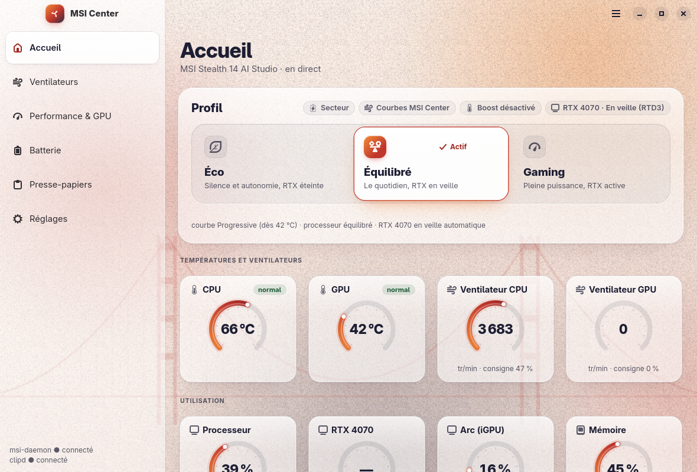 | 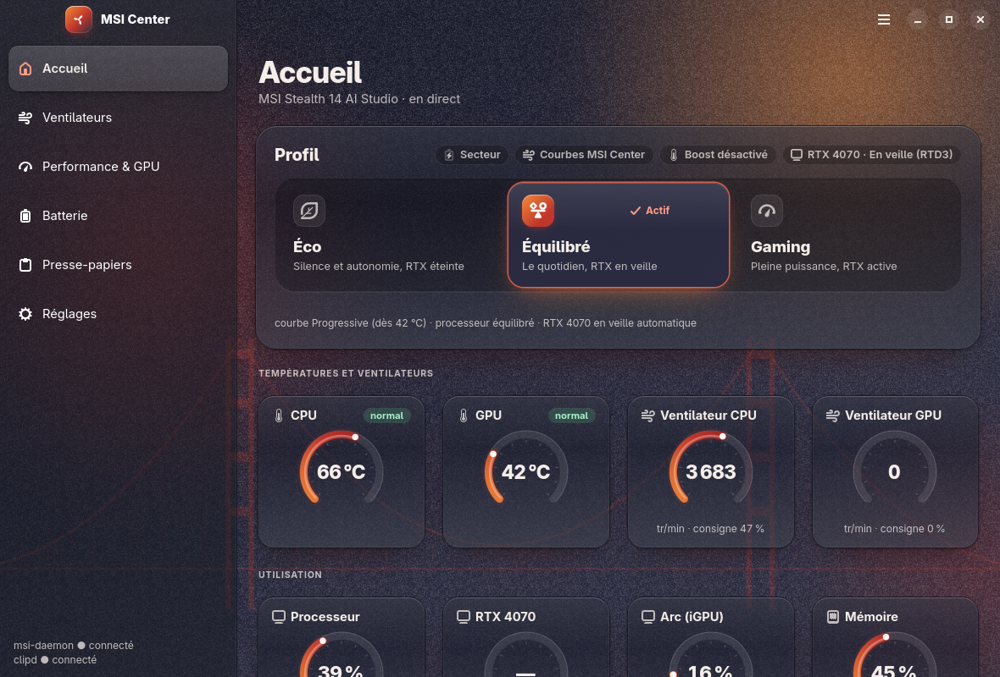 |
| Ventilateurs | 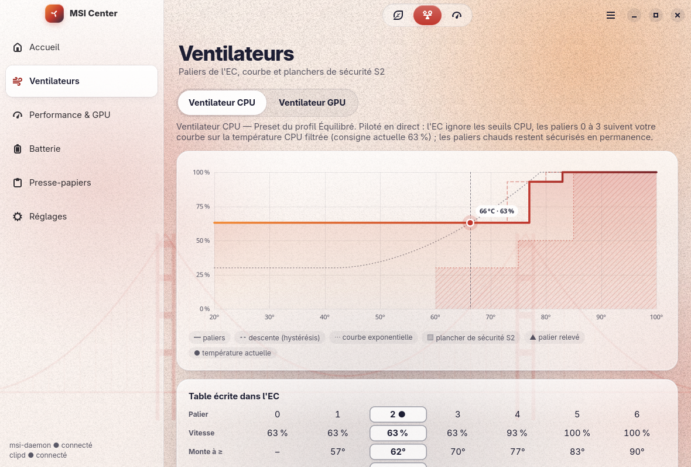 | 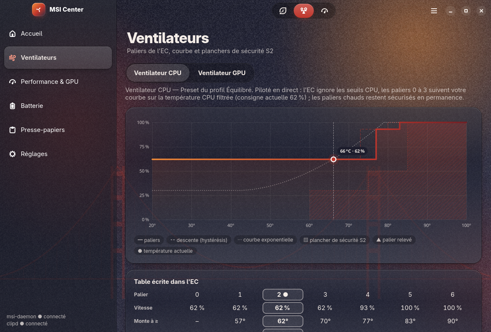 |
| Performance & GPU | 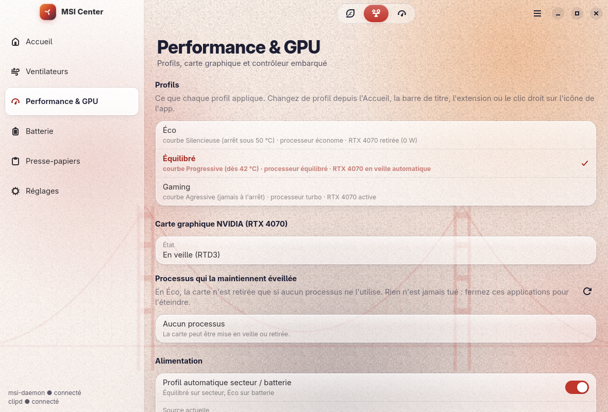 | 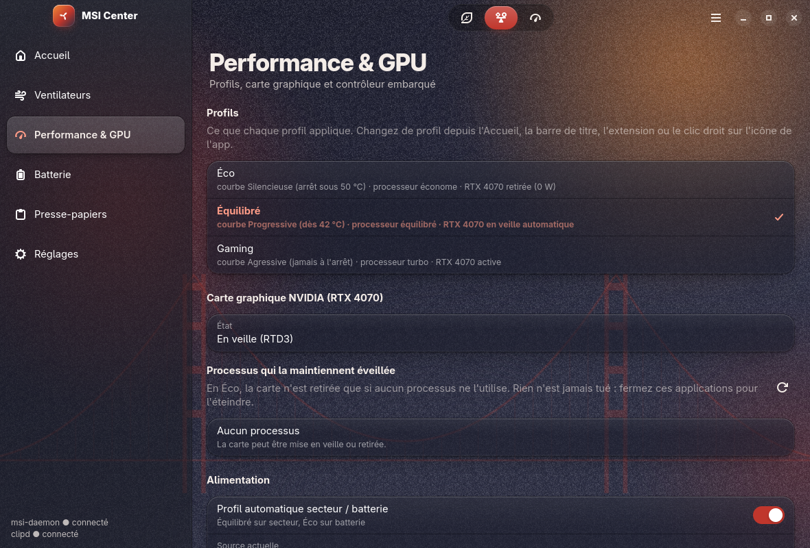 |
| Batterie | 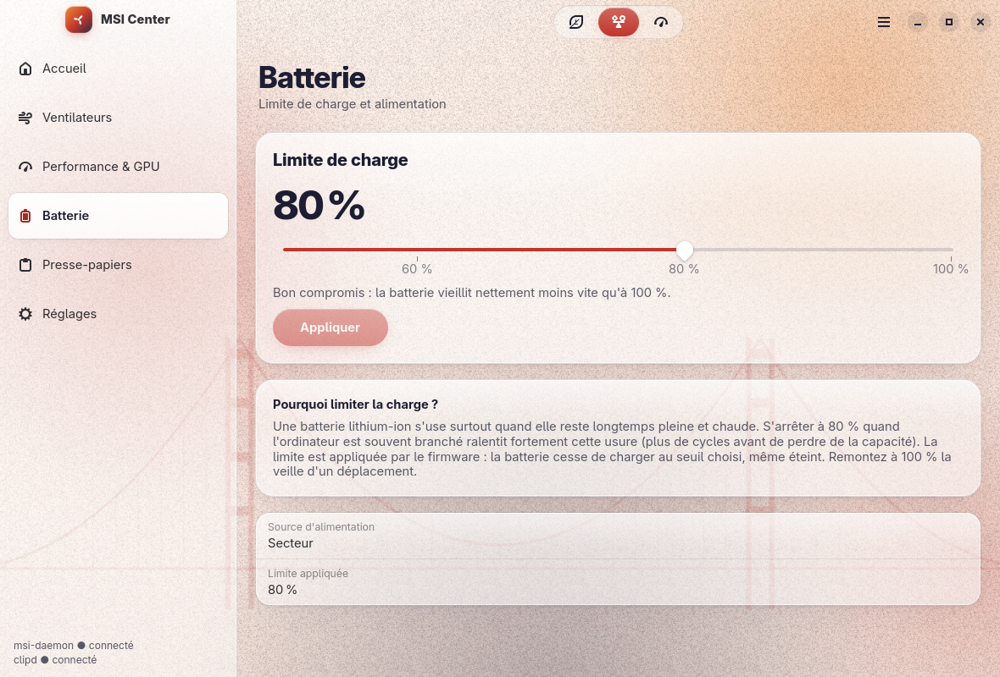 | 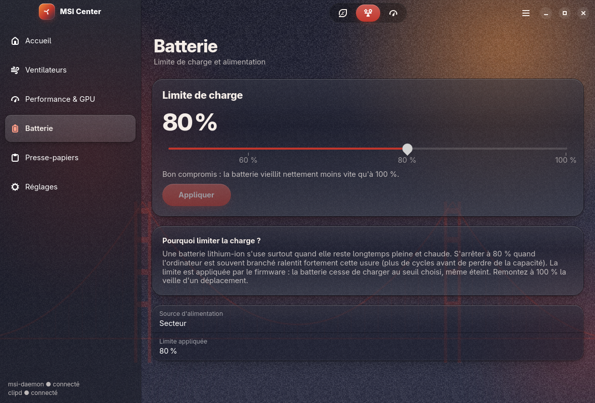 |
| Presse-papiers | 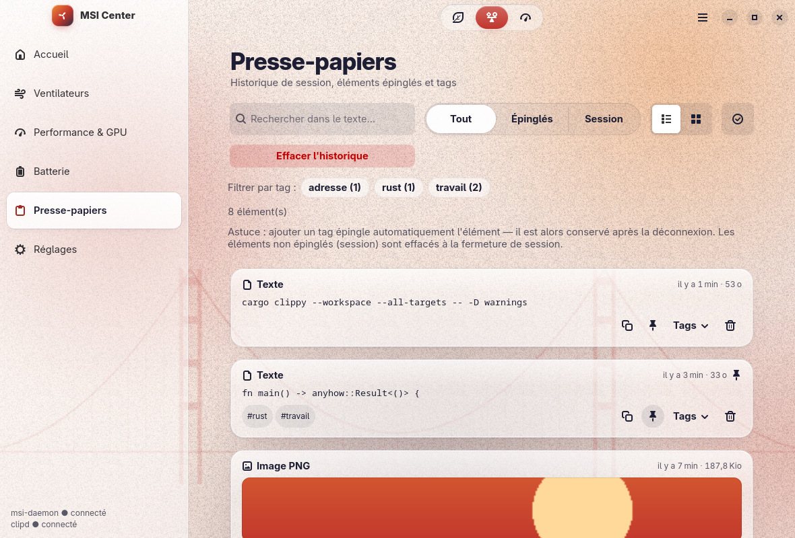 | 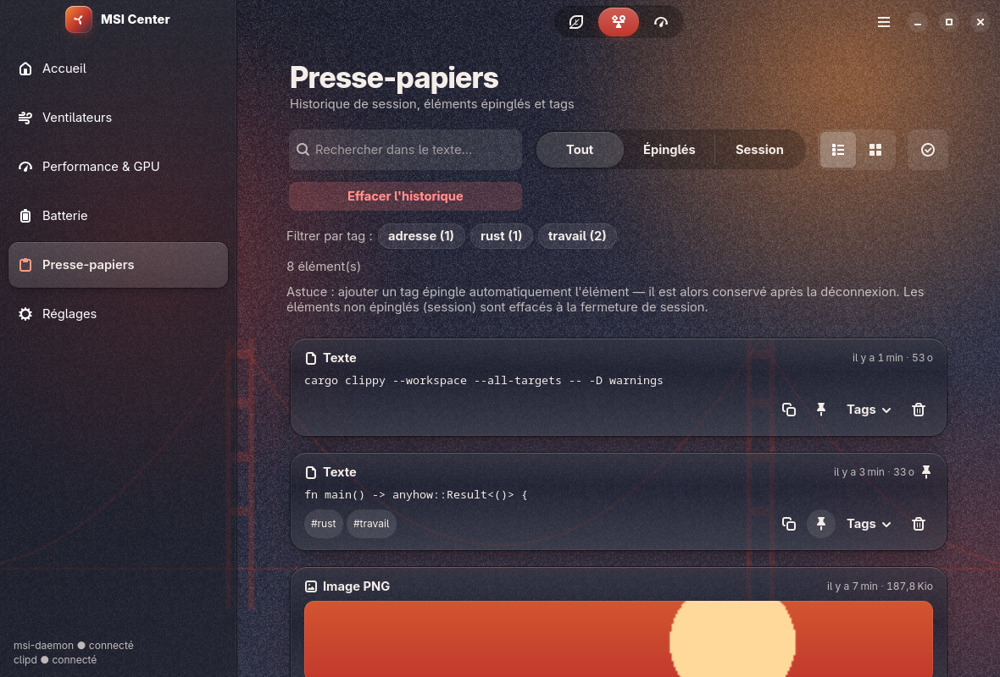 |
| Réglages | 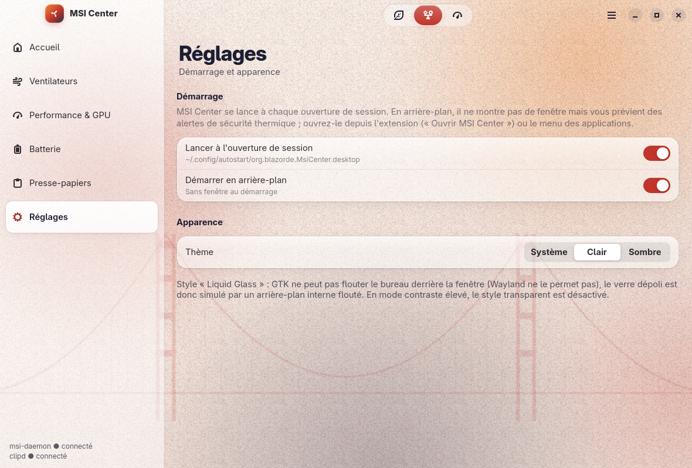 | 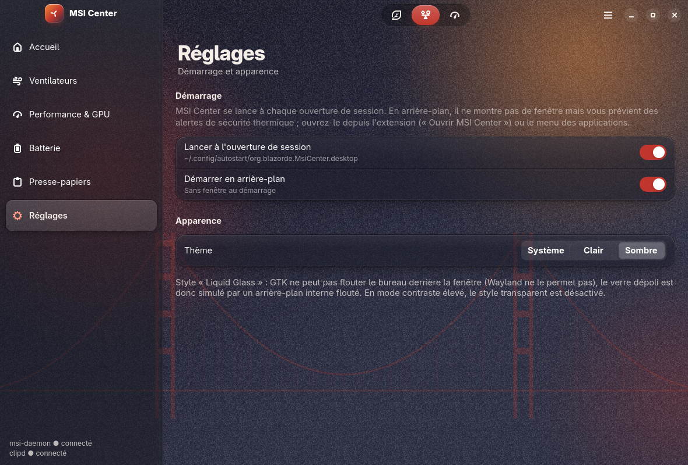 |

## Hors champ (limites GTK)

- Pas de flou du bureau derrière la fenêtre (Wayland) ni de « morphing » de formes de verre façon iOS 26.
- Pas de ressort physique en CSS GTK : courbes `cubic-bezier` fortes à la place.
