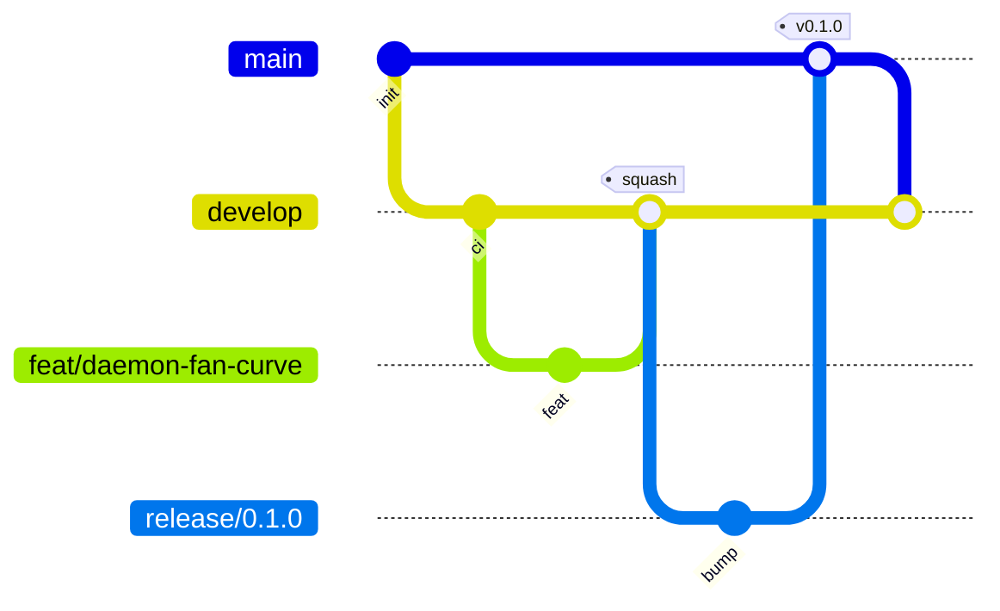

# Workflow git, branches, CI, releases

## Branches



| Branche | Rôle | Protégée | Merge |
|---|---|---|---|
| `main` | Versions publiées uniquement, chaque commit = un tag | ✅ | merge commit depuis `release/*` ou `hotfix/*` |
| `develop` | Intégration, toujours verte | ✅ | squash depuis les branches de travail |
| `feat/*`, `fix/*`, `docs/*`, `chore/*`, `refactor/*`, `test/*`, `perf/*`, `ci/*` | Travail, vie courte | – | → `develop` |
| `release/x.y.z` | Gel, bump version, changelog | – | → `main`, puis `main` → `develop` |
| `hotfix/x.y.z` | Correctif urgent depuis `main` | – | → `main`, puis `main` → `develop` |

Nommage : `feat/<scope>-<description-courte>`, ex. `feat/clipd-tags`, `fix/daemon-restore-auto`.

## Commits — Conventional Commits

```
<type>(<scope>): <résumé à l'impératif, ≤ 72 car.>

<corps optionnel : pourquoi>

<footer optionnel : BREAKING CHANGE:, Refs #12>
```

Types : `feat` `fix` `docs` `refactor` `test` `perf` `chore` `ci` `build`.
Scopes : `core` `daemon` `clip` `clipd` `app` `ext` `kernel` `pkg` `ci` `docs`.
Le hook `commit-msg` refuse tout message non conforme. Le titre de PR doit aussi respecter ce format, car il
devient le message du squash.

## Pull requests

- Template obligatoire (`.github/pull_request_template.md`).
- `scripts/ci.sh` vert avant d'ouvrir la PR (le hook `pre-push` le garantit).
- Branche à jour avec `develop` avant merge.

## CI — locale (pas de GitHub Actions)

Le quota GitHub Actions n'est pas disponible : la CI tourne sur la machine de dev ([ADR-0007](../adr/0007-local-ci.md)).

| Quoi | Quand | Fait |
|---|---|---|
| `scripts/ci.sh` | à la main, et via le hook `pre-push` | `fmt`, `clippy -D warnings`, `test`, `cargo deny` (licences/vulnérabilités) |
| `.githooks/commit-msg` | à chaque commit | Conventional Commits, ≤ 72 caractères |
| `scripts/release.sh x.y.z` | release depuis `main` | CI, build release, tag, release GitHub avec notes du CHANGELOG |
| Dependabot | hebdo | MAJ cargo → PR sur `develop` |

Activer les hooks (une fois par clone) : `git config core.hooksPath .githooks`.
`git push --no-verify` : urgences uniquement.

## Versionnage

[SemVer](https://semver.org/lang/fr/). Version unique pour tout le workspace (`[workspace.package] version`).
`CHANGELOG.md` au format [Keep a Changelog](https://keepachangelog.com/fr/1.1.0/).

## Faire une release

```bash
git switch develop && git pull
git switch -c release/0.1.0
# bump version dans Cargo.toml, déplacer [Unreleased] → [0.1.0] dans CHANGELOG.md
git commit -am "chore(release): 0.1.0"
gh pr create --base main --title "chore(release): 0.1.0"
# après merge (merge commit) :
git switch main && git pull
scripts/release.sh 0.1.0          # CI, build, tag v0.1.0, release GitHub
git switch develop && git merge main && git push   # via PR si develop refuse le push direct
```

## Protection des branches (en place)

`main` et `develop` : PR obligatoire (0 approbation, revues obsolètes rejetées), discussions résolues avant merge,
pas de force-push, pas de suppression. Pas de checks requis côté serveur (CI locale).
Squash et merge commit autorisés, rebase désactivé, branche supprimée après merge.
