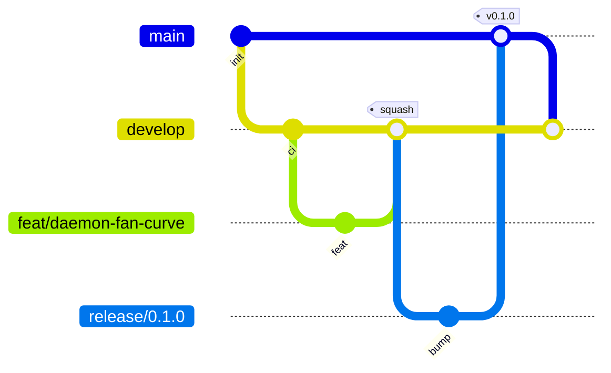

# Workflow git, branches, CI, releases

## Branches



| Branche | Rôle | Protégée | Merge |
|---|---|---|---|
| `main` | Versions publiées uniquement, chaque commit = un tag | ✅ | merge commit depuis `release/*` ou `hotfix/*` |
| `develop` | Intégration, toujours verte | ✅ | squash depuis les branches de travail |
| `feat/*`, `fix/*`, `docs/*`, `chore/*`, `refactor/*`, `test/*` | Travail, vie courte | – | → `develop` |
| `release/x.y.z` | Gel, bump version, changelog | – | → `main`, puis `main` → `develop` |
| `hotfix/x.y.z` | Correctif urgent depuis `main` | – | → `main`, puis `main` → `develop` |

Nommage : `feat/<scope>-<description-courte>`, ex. `feat/clipd-tags`, `fix/daemon-restore-auto`.

## Commits — Conventional Commits

```
<type>(<scope>): <résumé à l'impératif, ≤ 72 car.>

<corps optionnel : pourquoi>

<footer optionnel : BREAKING CHANGE:, Refs #12>
```

Types : `feat` `fix` `docs` `refactor` `test` `perf` `chore` `ci` `build`.
Scopes : `core` `daemon` `clip` `clipd` `app` `ext` `kernel` `pkg` `ci` `docs`.
Le titre de PR doit aussi respecter ce format (vérifié en CI), car il devient le message du squash.

## Pull requests

- Template obligatoire (`.github/pull_request_template.md`).
- CI verte requise : fmt, clippy `-D warnings`, tests, audit des dépendances.
- Branche à jour avec `develop` avant merge.

## CI (GitHub Actions)

| Workflow | Déclencheur | Jobs |
|---|---|---|
| `ci.yml` | PR + push sur `main`/`develop` | `fmt`, `clippy`, `test`, `deny` (licences/vulnérabilités) |
| `pr-title.yml` | PR | Vérifie le format Conventional Commits du titre |
| `release.yml` | Tag `v*.*.*` | Build release, archive, release GitHub avec notes du CHANGELOG |
| Dependabot | Hebdo | MAJ cargo + actions → PR sur `develop` |

## Versionnage

[SemVer](https://semver.org/lang/fr/). Version unique pour tout le workspace (`[workspace.package] version`).
`CHANGELOG.md` au format [Keep a Changelog](https://keepachangelog.com/fr/1.1.0/).

## Faire une release

```bash
git switch develop && git pull
git switch -c release/0.1.0
# bump version dans Cargo.toml, déplacer [Unreleased] → [0.1.0] dans CHANGELOG.md
git commit -am "chore(release): 0.1.0"
gh pr create --base main --title "chore(release): 0.1.0"
# après merge :
git switch main && git pull && git tag -a v0.1.0 -m "v0.1.0" && git push origin v0.1.0
git switch develop && git merge main && git push
```

## Protection des branches (à appliquer une fois le dépôt créé)

`main` et `develop` : PR obligatoire, checks `fmt`, `clippy`, `test`, `deny` requis, pas de force-push, pas de suppression.
Commande `gh api` fournie dans le README de mise en place lors de la création du dépôt distant.
