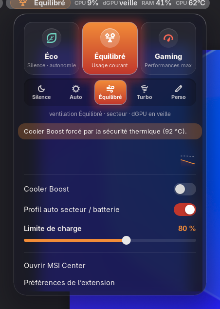
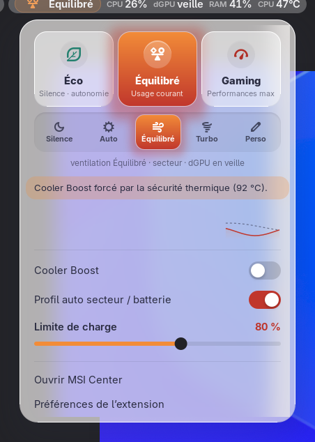
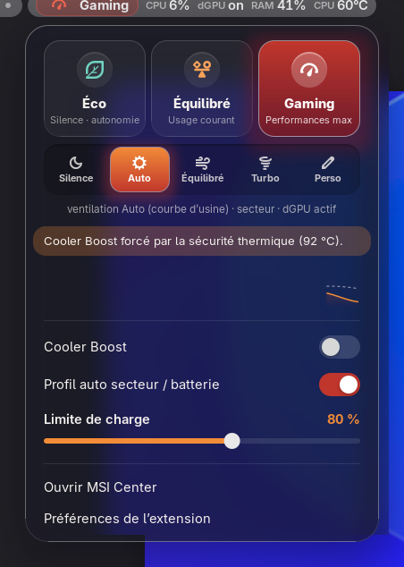
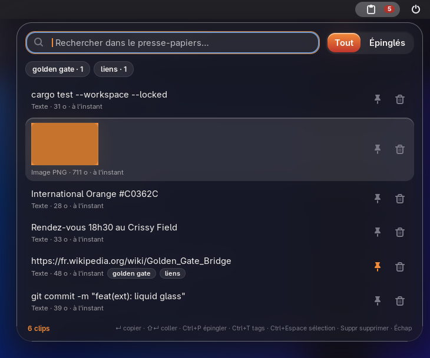
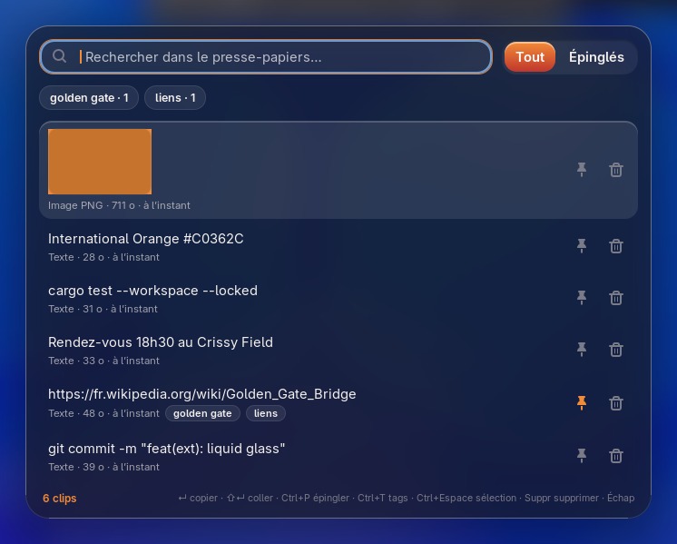
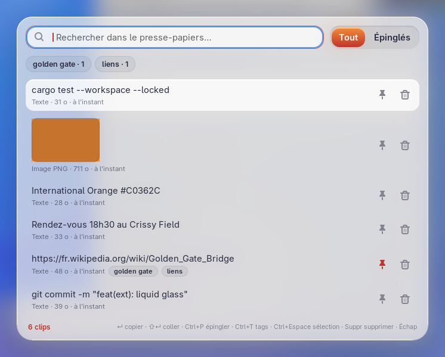

# Extension GNOME Shell `msi-center@blazorde`

Frontend fin (aucune logique métier, [ADR-0004](../adr/0004-gnome-extension-gjs.md)) au-dessus de deux services :
`msi-daemon` (bus système, `org.blazorde.MsiCenter1`) et `clipd` (bus session, `org.blazorde.Clipd1`). Contrats :
[API D-Bus](../architecture/dbus-api.md). Cible : GNOME Shell 51 (Wayland).

Barre supérieure : **à gauche** (juste après Activités) le profil courant puis les métriques ; **à droite** le
bouton presse-papiers.

| Gauche : profil + métriques | Droite : presse-papiers |
|---|---|
|  |  |

| Menu (sombre) | Menu (clair) | Après un clic sur Gaming |
|---|---|---|
|  |  |  |

| Bouton presse-papiers | Historique `Super+V` (sombre) | Historique `Super+V` (clair) |
|---|---|---|
|  |  |  |

> Captures prises dans un GNOME Shell headless isolé avec un faux `msi-daemon` (`scripts/ext-smoke.sh`).

## Installation et démarrage automatique

```bash
scripts/ext-install.sh                         # paquet + installation utilisateur + schémas (sans sudo)
gnome-extensions enable msi-center@blazorde    # une seule fois
```

Une fois **activée, l'extension est chargée par GNOME Shell à chaque ouverture de session** : rien d'autre à
faire pour qu'elle « se lance au démarrage ». `scripts/ext-install.sh --enable` fait les deux étapes.

- Sous Wayland, une extension **nouvellement installée** n'est vue par GNOME Shell qu'après une
  déconnexion / reconnexion. Une mise à jour d'une extension déjà installée demande aussi une reconnexion.
- `clipd` est démarré automatiquement par activation D-Bus au premier besoin (voir `systemd/`).
- `msi-daemon` **n'est jamais démarré par l'extension** (pas d'auto-activation D-Bus) : au démarrage, le daemon
  écrit les courbes dans l'EC, et le propriétaire doit rester maître de son lancement
  (`systemctl enable --now msi-daemon`). Tant qu'il est absent, l'icône est grisée, le menu l'indique et
  l'extension se reconnecte d'elle-même dès qu'il apparaît.

Désinstaller : `gnome-extensions uninstall msi-center@blazorde`.

## Barre supérieure

Deux boutons indépendants, chacun déplaçable dans les préférences (zone gauche / centre / droite + position) :

| Bouton | Place par défaut | Contenu |
|---|---|---|
| **Indicateur principal** | gauche, juste après Activités | profil courant (glyphe + nom court, une teinte par profil) puis les métriques |
| **Presse-papiers** | droite, avant les icônes système | icône seule + pastille discrète (nombre de clips de la session) |

Profils : **Éco** (feuille, teal « Pacifique »), **Équilibré** (balance, coucher de soleil orange), **Gaming**
(compteur, International Orange). Daemon absent : logo MSI grisé, pas de nom.

Métriques, mises à jour par le signal `Telemetry` (~1 Hz, poussé par le daemon, aucun polling) :

| Métrique | Exemple | Source (`Telemetry`) |
|---|---|---|
| CPU | `CPU 12%` | `cpu_pct` |
| dGPU | `dGPU 30%`, `dGPU on`, `dGPU veille`, `dGPU off` | `dgpu_pct`, sinon `dgpu_state` (la charge n'est lue qu'en Gaming) |
| iGPU | `iGPU 7%` | `igpu_pct` |
| RAM | `RAM 41%` | `ram_pct` |
| NPU | `NPU 0%` | `npu_pct` |
| Température CPU / GPU | `CPU 62°C` | `cpu_temp`, `gpu_temp` |
| Ventilateurs | `2400·2100 tr/min` | `fan1_rpm`, `fan2_rpm` |

Chaque métrique s'active dans les préférences, l'ordre se change avec les flèches, et le mode « icône seule »
masque le nom du profil et les métriques (le glyphe coloré reste). Une clé absente du signal masque simplement
la métrique.

### Changer de profil sans commande

- **Clic** sur l'indicateur : le menu s'ouvre sur trois grandes pastilles **Éco / Équilibré / Gaming**. Un clic
  = `SetProfile`. La pastille choisie s'allume **tout de suite** avec un indicateur d'activité ; si le daemon
  refuse (polkit, lecture seule…), elle revient au profil réel avec un léger tremblement et un bandeau d'erreur.
- **Clavier** : le menu ouvert au clavier place le focus sur le profil courant ; `←` `→` pour changer de
  pastille, `Entrée` / `Espace` pour appliquer.
- **Molette** sur l'indicateur (option, désactivée par défaut) : vers le haut = plus performant, vers le bas =
  plus silencieux, sans boucler ; un cran par geste.
- **Raccourci** « profil suivant » (option, aucun par défaut, ex. `<Super>F5`) : Éco → Équilibré → Gaming → Éco.
  Menu fermé, l'OSD GNOME affiche le nouveau profil.

## Menu

- **Profils** : les trois pastilles (voir ci-dessus), puis une rangée de cinq puces **Silence / Auto /
  Équilibré / Turbo / Perso** : le profil de ventilation du profil actif (un clic = `SetFanProfile`, retenu par
  profil ; allumage immédiat avec indicateur d'activité, retour en arrière et bandeau d'erreur si le daemon
  refuse ; `←` `→` pour naviguer). Le choix par défaut du profil a un fin trait. **Auto** = courbe d'usine MSI
  gérée par le contrôleur ; Turbo n'est pas Cooler Boost. Puis une ligne d'état : profil de ventilation,
  secteur/batterie, état du dGPU. (Avec un daemon plus ancien sans `FanProfile`, la rangée est masquée.)
- **Bandeaux** : daemon absent, **lecture seule** (`ReadOnly` + `ReadOnlyReason`, commandes désactivées),
  événements de sécurité (`SafetyEvent` : Cooler Boost forcé, retour en mode auto…), erreurs d'appel (polkit,
  `GpuBusy` avec la liste des processus qui tiennent le dGPU). Cliquer sur un bandeau le ferme.
- **Mini-graphe** : CPU % (aire) et °C (pointillés) sur 60 s (désactivable).
- **Cooler Boost** (`SetCoolerBoost`) : non désactivable quand la sécurité thermique le force (S4).
- **Profil auto secteur / batterie** (`SetAutoProfileOnPower`).
- **Limite de charge** 50–100 % (`SetChargeLimit`), appliquée **au relâchement** du curseur (ou après une pause
  au clavier / à la molette). Masquée si non supportée (`ChargeLimit = 0`).
- **Ouvrir MSI Center** (app `org.blazorde.MsiCenter`, via son fichier `.desktop` ou
  `org.freedesktop.Application.Activate`), **Préférences**. L'entrée **Historique du presse-papiers** n'apparaît
  que si le bouton presse-papiers est masqué.

## Presse-papiers

Tout ce qui est copié (texte et images, **y compris depuis un gestionnaire de mots de passe**, choix du
propriétaire) est envoyé à `clipd` (`Add`). Le texte est préféré quand une copie propose texte et image (cas des
tableurs). Les clips non épinglés vivent en tmpfs et disparaissent au logout ; épingler (ou taguer) les rend
permanents. Désactivable : préférence « Capturer le presse-papiers ».

### Bouton de la barre

Un clic sur l'icône presse-papiers (à droite) ouvre l'historique **sous le bouton** (la popup grandit depuis
l'icône, la barre reste nette et le bouton allumé) ; un clic à côté ou `Échap` ferme. La pastille compte les
clips de la session (non épinglés, effacés au logout), masquée à zéro. Préférences : masquer le bouton (l'entrée
revient alors dans le menu principal), masquer la pastille, changer sa zone et sa position.

### Popup `Super+V`

Ouverte au clavier, elle apparaît centrée par un simple fondu très court (pas d'animation de taille : c'est un
geste répété toute la journée).

| Touche | Action |
|---|---|
| (frappe) | Recherche plein texte (insensible à la casse) |
| `↑` `↓` `Page↑` `Page↓` `Ctrl+Début/Fin` | Navigation |
| `Entrée` | Copier le clip dans le presse-papiers et fermer |
| `Maj+Entrée` | Copier **et coller** (Ctrl+V simulé ; inverse si « Coller après sélection » est actif) |
| `Ctrl+P` | Épingler / désépingler |
| `Ctrl+T` | Éditer les tags (séparés par des virgules ; taguer épingle) |
| `Ctrl+Espace`, `Ctrl+clic` | Sélection multiple ; `Ctrl+A` tout sélectionner |
| `Suppr` (recherche vide) / `Ctrl+Suppr` | Supprimer le clip courant ou la sélection |
| `Tab` | Aller aux filtres (tags, Tout / Épinglés) |
| `Échap` / clic à côté | Fermer |

Les puces de tags filtrent la liste (ET logique). Les images ont une vignette (récupérée avec `Get`, décodée en
asynchrone, cache LRU limité par « Cache de vignettes », 32 Mio par défaut).

**Conflit de raccourci** : GNOME associe aussi `Super+V` à la liste des notifications
(`org.gnome.shell.keybindings toggle-message-tray`). Les préférences de l'extension proposent un bouton
« Libérer Super+V » (qui garde `Super+M`), ou en ligne de commande :

```bash
gsettings set org.gnome.shell.keybindings toggle-message-tray "['<Super>m']"
```

Le raccourci se change dans les préférences (format GTK, ex. `<Super><Shift>v`).

## Style « Liquid Glass » × Golden Gate

Panneaux translucides dépolis (`Shell.BlurEffect`), grands rayons concentriques (menu 26 px, pastilles
26 − 8 = 18 px), liseré spéculaire en haut, ombres douces teintées. Palette : International Orange `#C0362C`,
dégradé `#F28C38 → #C0362C`, indigo `#2B2D42`, et une teinte par profil (Éco `#3FA796 → #22616E`, Équilibré
`#F28C38 → #C0362C`, Gaming `#C0362C → #6E1A2B`).

Mouvement : uniquement des courbes « ease-out » courtes (appui 90 ms à 96 %, relâchement 160 ms ; popup depuis
le bouton 180 ms en partant de l'icône ; fermeture 110 ms, toujours plus rapide que l'ouverture). Tout est
désactivé si les animations GNOME le sont (Accessibilité → réduire les animations).
Variantes claire et sombre selon le thème système. Tous les jetons sont documentés en tête de
`extension/msi-center@blazorde/stylesheet.css`.

## Recharger après une mise à jour

`scripts/ext-install.sh` puis **déconnexion / reconnexion** (Wayland ne recharge pas une extension à chaud). Les
nouveaux réglages (emplacements, molette, raccourci) prennent leurs valeurs par défaut : indicateur à gauche,
presse-papiers à droite.

## Limitations connues

- Le flou du menu est un rectangle légèrement en retrait sous le verre arrondi (Clutter 51 n'a pas de découpe
  arrondie et le menu GNOME est rendu hors écran) ; la popup `Super+V` floute tout l'écran derrière elle.
- « Coller » simule `Ctrl+V` : les terminaux qui attendent `Ctrl+Maj+V` ne collent pas (le clip est quand même
  dans le presse-papiers).
- Seul le presse-papiers `CLIPBOARD` est capturé (pas la sélection primaire).
- Pendant l'écran de verrouillage, l'extension est désactivée (rien n'est capturé).
- Textes en français uniquement (pas de gettext).

## Développement

| Commande | Rôle |
|---|---|
| `scripts/ext-check.sh` | Hors-ligne, ~1 s, appelé par `scripts/ci.sh` : syntaxe (`node --check`), imports relatifs, tests unitaires des fonctions pures (`node --test extension/tests/`), `metadata.json`, schéma (`glib-compile-schemas --strict`), `gnome-extensions pack`, ESLint s'il est installé localement. |
| `scripts/ext-smoke.sh [--shots DIR]` | Manuel, ~30 s : GNOME Shell **headless isolé** (bus session et « système » privés, faux `msi-daemon` `extension/tests/mock-msi-daemon.js`, vrai `clipd`, GSettings en mémoire) qui vérifie la disposition (indicateur à gauche après Activités, bouton presse-papiers à droite, pastille), le
changement de profil optimiste et son retour arrière sur erreur, la molette/raccourci, la popup ancrée, capture,
tags, suppression, thème clair, déplacement live des boutons et cycle disable/enable. `--shots DIR` produit les
captures de cette page. Ne touche ni la session ni le vrai daemon. |
| `journalctl --user -f -o cat /usr/bin/gnome-shell` | Logs de l'extension en session réelle. |

ESLint : configuration GJS dans `extension/eslint.config.mjs` ; non téléchargé automatiquement (CI hors-ligne).
Pour l'activer : `cd extension && npm i -D eslint` (le script le détecte ensuite).

**Ne jamais tester l'extension contre le vrai bus système** (shell imbriqué, `gjs`…) : cela pourrait réveiller
`msi-daemon`, qui ré-écrit l'EC. Utiliser `scripts/ext-smoke.sh`.
